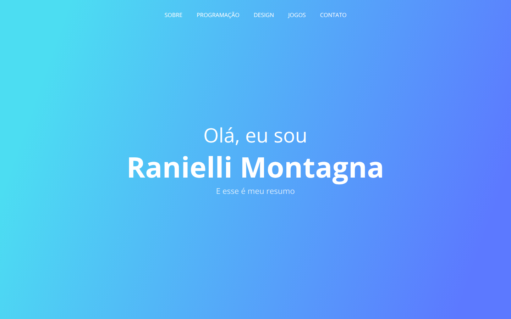
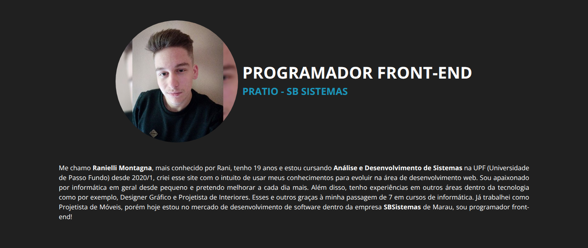
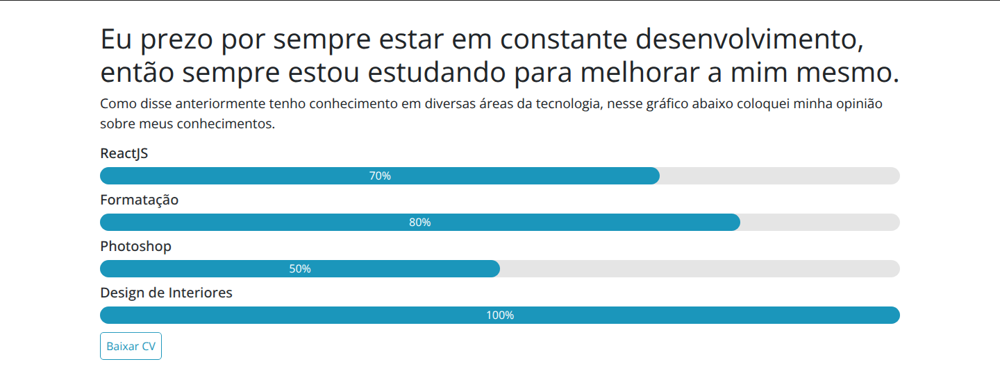
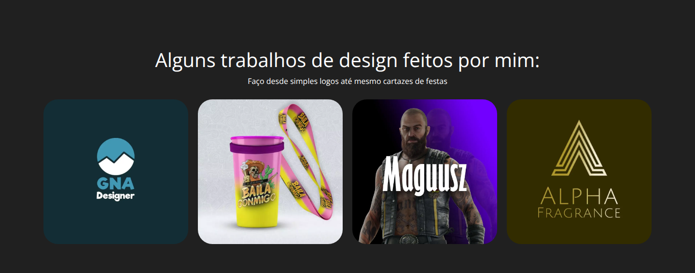
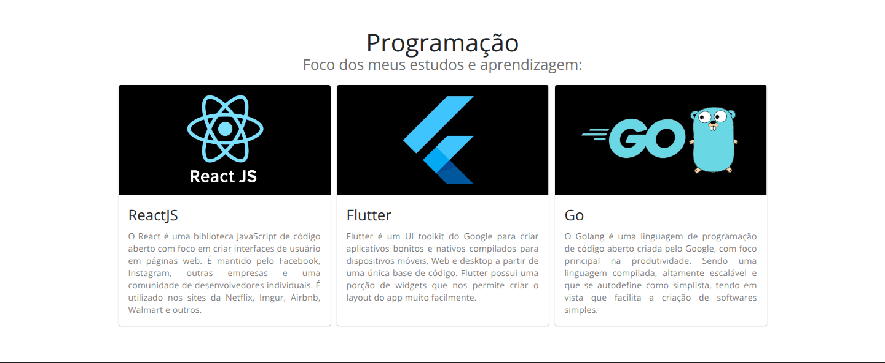

<div align="center">

# raniWebsite

**My first personal site, from 2021. Questionable design and CSS of dubious origin, kept as a humble reminder of where I started.**


[**Live site**](https://rani-website.vercel.app/) •
[Features](#features) •
[Screenshots](#screenshots) •
[Project layout](#project-layout) •
[Running locally](#running-locally) •
[History](#project-history)

</div>

> [!WARNING]
> **Discontinued.** raniWebsite is no longer maintained and this repository is archived as a portfolio reference. The September 2021 version is still online at [rani-website.vercel.app](https://rani-website.vercel.app/). My current site is [ranimontagna.com](https://ranimontagna.com).



## About

I built this site in February 2021, in my first year of Systems Analysis and Development at UPF and a few months before my first developer job, and polished it in September 2021. It was my first React project after the Create React App template: each section is a component with its own CSS file. The page is in Portuguese. It was followed by [rani-website](https://github.com/RanielliMontagna/rani-website) in 2022.

## Features

- **Intro** with a gradient background, a typewriter greeting and a menu that jumps to each section.
- **About** with my photo, my role at the time and a short bio.
- **Skills** as progress bars, with a button to download my CV.
- **Design work**: logos and mockups from my time as a graphic designer.
- **Programming**: cards for React, Flutter and Go, the technologies I was studying.
- **Games**: a carousel with my favorite games, built with react-image-gallery.
- **Contact** form and contact details. The form is layout only and never sends anything.
- Scroll animations with AOS, and Open Graph, Twitter and Google Search meta tags.

## Screenshots

Taken in October 2026 from a local production build. The styles ask for Segoe UI, which only Windows has, so these screenshots use Open Sans.

<table>
  <tr>
    <td colspan="2"><p align="center"><sub>About</sub></p></td>
  </tr>
  <tr>
    <td width="50%"><p align="center"><sub>Skills and CV download</sub></p></td>
    <td width="50%"><p align="center"><sub>Design work</sub></p></td>
  </tr>
  <tr>
    <td colspan="2"><p align="center"><sub>What I was studying</sub></p></td>
  </tr>
</table>

## Project layout

```text
public/                    # index.html with the meta tags, manifest, icons, CV, technology and game images
src/
├── pages/Home.jsx         # puts the sections in order and starts AOS
├── components/divs/       # Intro, About, Cv, DesignerWorks, Programming, Games, Contact and Footer, each with its CSS;
│                          # Header, Main and Quote are from the first layout and are no longer rendered
├── components/layout/     # Material UI card used by the programming section
└── images/                # photo, logos and design work
```

## Tech stack

| Area | Tools |
| --- | --- |
| UI | React 17, JavaScript, plain CSS per section on top of Bootstrap 4, Material UI 4 cards, React Icons |
| Effects | AOS, typewriter-effect, react-image-gallery |
| Build | Create React App 4 (react-scripts 4.0.2) |
| Hosting | Vercel |

## Running locally

Last checked in October 2026. Create React App 4 needs Node.js 16.

```bash
git clone https://github.com/RanielliMontagna/raniWebsite.git
cd raniWebsite
nvm use 16    # or: fnm use 16
npm ci

npm start       # http://localhost:3000
npm run build
```

There are no tests: the Create React App placeholder test looked for a "learn react" link that never existed on this page, so it failed from the first commit and was removed in October 2026.

## Project history

- **February 2021**: started from Create React App. The first layout had a header, main banner, about, programming, games, quote and footer sections, with a typewriter and scroll effects. A CV download and the design work section came next, images were compressed and converted to WebP, and the layout was reworked around the intro and contact sections. Segoe UI became the font.
- **May–June 2021**: about text rewritten.
- **September 2021**: new photo and carousel, logo and icon, Open Graph and Twitter tags, a Content Security Policy that was tried and taken out, and image sizes. Last commit on 16 September 2021.
- **2022**: replaced by rani-website.
- **October 2026**: archived.

## Author

Built by [Ranielli Montagna](https://github.com/RanielliMontagna) · [ranimontagna.com](https://ranimontagna.com)
